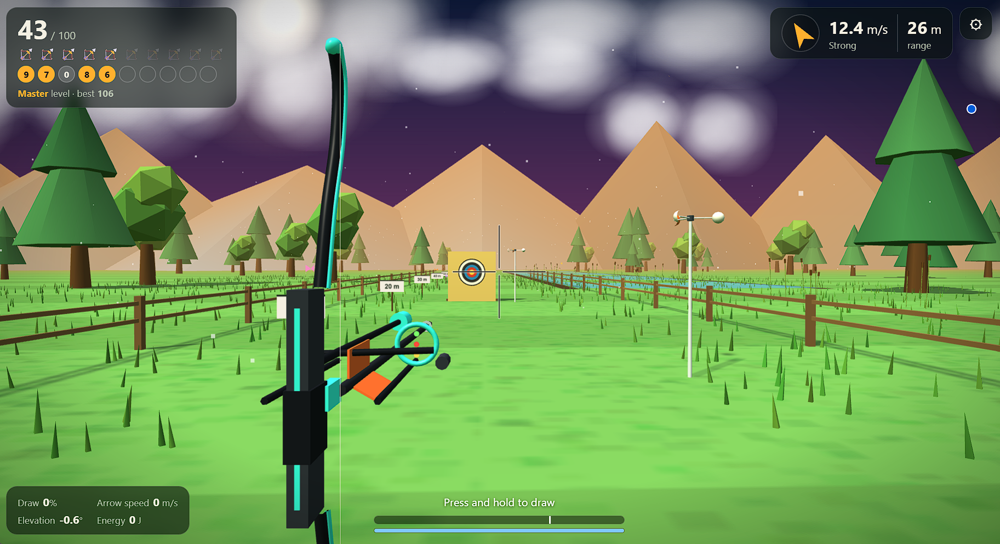
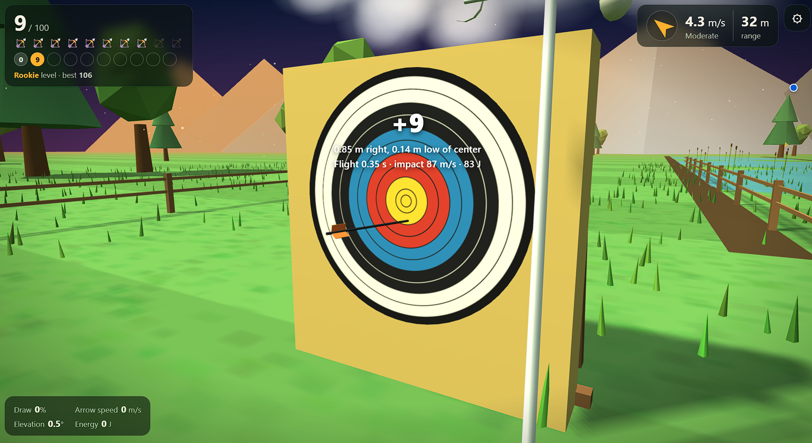
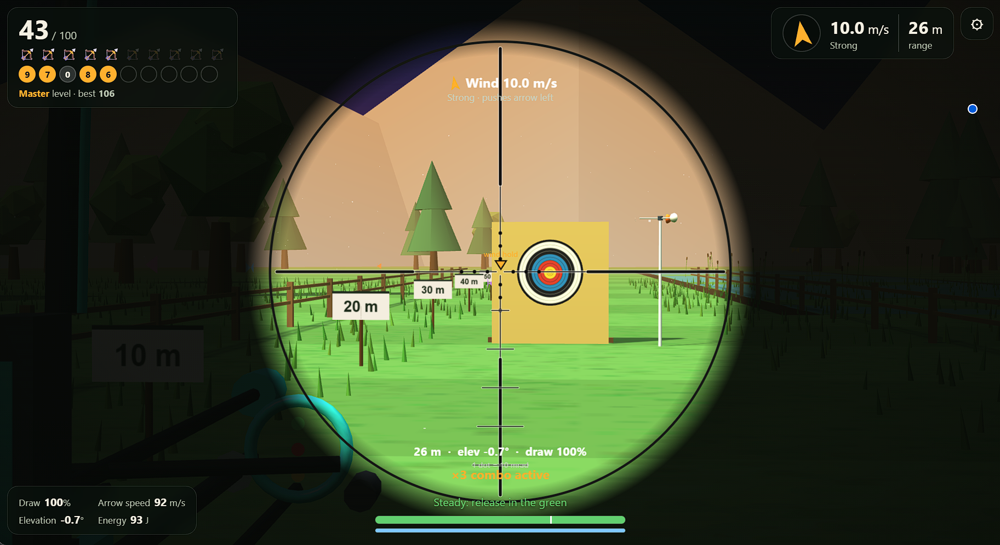

# 🏹 Longbow Range 3D

> A first-person archery game built entirely in the browser with realistic ballistic physics, a live scope reticle, real-world sky sync, and difficulty that scales with your best score.

**🌐 Play now → [shootingfunprakhar.netlify.app](https://shootingfunprakhar.netlify.app/)**

---

## 📸 Screenshots

<p align="center">
  
  <em>Night sky, recurve bow drawn, full 3D range with trees, grass tufts and anemometers</em>
</p>

<p align="center">
  
  <em>Scope zoomed in at full draw — wind hold marker, drop ladder, ×3 combo active, golden-hour sky</em>
</p>

<p align="center">
  
  <em>+9 ring hit — impact position, flight time, speed and energy shown on result screen</em>
</p>

---

## 🎮 Overview

Longbow Range 3D puts you on an outdoor archery range rendered in real-time 3D using Three.js. Every arrow obeys ballistic physics — gravity, quadratic air drag, wind drift, and archer's paradox wobble. The sky matches your actual local time of day. Land ten arrows, beat your best score, and climb from Rookie to Master.

---

## 🕹️ How to Play

| Step | Action |
|------|--------|
| **Aim** | Move the mouse (desktop) or drag your finger (mobile) |
| **Draw** | Press and hold left-click / tap — hold until the draw bar passes the white marker |
| **Release** | Let go while the bar is in the green zone for a clean shot |
| **Steady** | Hold **Space** (desktop) or the **Hold Breath** button (mobile) to suppress sway |
| **Quick restart** | Press **R** on the results screen |
| **Toggle aim assist** | Press **B** to show/hide the predicted landing point |

### Scoring

- **10 rings** on the target face, worth 1–10 points from edge to bullseye
- **10 arrows** per round, maximum score **100**
- Hit the straw bale (outside the rings) = 0 points
- Miss completely = 0 points + dirt crater on the ground

### Combo Multiplier

Consecutive hits stack a multiplier:

| Streak | Multiplier |
|--------|-----------|
| 1st hit | ×1 |
| 2nd hit | ×2 |
| 3rd hit onward | ×3 |

A miss resets the streak. A ×3 bullseye scores **30 points** from one arrow.

---

## ⚙️ Settings

| Setting | Options | Notes |
|---------|---------|-------|
| **Bow** | Compound · Recurve | Visual difference only — same physics |
| **Difficulty** | Auto · Easy · Normal · Hard | Auto scales to your best score |
| **Sensitivity** | 0.3 → 2.5 | Aim sensitivity slider |
| **Aim assist** | On / Off | Shows the predicted arrow landing point |

---

## 🏆 Difficulty & Progression

Difficulty is a 0–1 scalar `D` that controls everything:

| Tier | D | Wind max | Range | Target radius |
|------|---|----------|-------|---------------|
| Rookie | 0.00–0.30 | 3–6 m/s | 15–34 m | 0.90 m |
| Club | 0.30–0.55 | 6–9 m/s | 17–42 m | 0.82 m |
| Pro | 0.55–0.75 | 9–11 m/s | 19–53 m | 0.74 m |
| Elite | 0.75–0.90 | 11–13 m/s | 21–60 m | 0.68 m |
| Master | 0.90–1.00 | 13–14 m/s | 23–60 m | 0.65 m |

**Auto mode** sets `D = best_score / 100`. Beat your record and the range gets harder automatically.

**Hard difficulty extras:**
- 10-second shot timer per arrow (Normal = 14 s)
- Target sways left and right during your aim
- 40% chance of rain per round (adds visual sway noise)

---

## 🏹 Physics

Every arrow simulates real archery ballistics:

```
Launch speed  = 48 + 44 × draw_fraction  (m/s)
               → minimum valid draw (70%) = 79 m/s
               → full draw (100%)         = 92 m/s

Drag force    = K × |v_relative|² × v_relative
               K scales with difficulty (0.0019–0.0026)

Wind drift    = arrow flies through moving air mass
               crosswind shown as a hold mark in the scope

Archer's paradox = tip wobble: 0.05 × e^(−t×2.5) × sin(t×38) rad
```

The scope's **drop ladder** (horizontal lines below center) is calibrated at 30 mrad steps — use it to dial in elevation at longer distances.

---

## 🌤️ Real-World Sky Sync

The sky automatically matches your local clock — no setting required:

| Time | Sky |
|------|-----|
| 00:00 – 05:00 | Deep night — stars, moon |
| 05:00 – 08:00 | Dawn — orange sunrise |
| 08:00 – 17:00 | Full daylight |
| 17:00 – 19:00 | Golden hour |
| 19:00 – 22:00 | Dusk — purple-red |
| 22:00 – 00:00 | Night again |

Transitions are smooth and continuous. Stars, moon, sun intensity, cloud opacity, and fireflies all follow the same clock.

---

## 🌍 Scene Features

| Feature | Detail |
|---------|--------|
| **Animated river** | Sine-wave vertex animation, flows alongside the range |
| **Tall reeds** | 40 reeds sway with wind speed and direction |
| **Butterflies** | 6 coloured butterflies fly figure-eight paths, disappear at night |
| **Fireflies** | 32 glowing orbs drift near the trees after dark |
| **Birds** | 14 birds fly across the range, wings flapping |
| **Wind gusts** | Random gusts every 8–14 s with ⚠ alert banner |
| **Impact craters** | Dark dirt splash spawns on ground misses, fades in 8 s |
| **Target spotlight** | SpotLight tracks the target, flares gold on bullseye |
| **Lens flare** | Additive glint appears when looking toward the sun |
| **Screen shake** | Hit intensity scales camera shake — bullseye = maximum |
| **Rain** | 700-particle rain system on hard+ rounds |

---

## 🖥️ Controls Reference

### Desktop
| Input | Action |
|-------|--------|
| Mouse move | Aim |
| Left click + hold | Draw bow |
| Release left click | Fire |
| Space (hold) | Hold breath / steady aim |
| B | Toggle aim assist |
| R | Quick restart (results screen) |
| Arrow keys | Fine aim adjustment |
| ⚙ button | Settings / pause |

### Mobile
| Input | Action |
|-------|--------|
| Drag | Aim |
| Tap + hold | Draw bow |
| Release tap | Fire |
| Hold Breath button | Steady aim |

---

## 🛠️ Technical

| Item | Detail |
|------|--------|
| **Engine** | [Three.js r128](https://threejs.org/) via CDN |
| **Renderer** | WebGL (PCFSoft shadows, pixel ratio capped at 2×) |
| **Physics** | Custom sub-step ballistics at 2.5 ms intervals |
| **Collision** | Z-plane crossing + 3D proximity fallback (catches fast arrows) |
| **Build** | Zero build step — single `index.html`, no dependencies to install |
| **Storage** | `localStorage` for best score, settings |
| **Audio** | Web Audio API oscillators (no audio files) |
| **Sky** | Canvas texture repainted every frame from `new Date()` |

---

## 🚀 Run Locally

```bash
# Clone or download the repo, then just open the file:
open index.html

# Or serve it (required for some browsers due to CORS on local files):
npx serve .
# → http://localhost:3000
```

No npm install, no bundler, no build step.

---

## 📁 Project Structure

```
Archery_Game_Deployed/
├── assets/
│   ├── image.png        ← Scope view screenshot
│   ├── image2.png       ← Hit result screenshot
│   └── main_ground.png  ← Full range screenshot
├── index.html           ← Entire game (HTML + CSS + JS)
└── README.md
```

---

## 🎯 Score Grades

| Grade | Score |
|-------|-------|
| S | 90 – 100 |
| A | 70 – 89 |
| B | 50 – 69 |
| C | 30 – 49 |
| D | 0 – 29 |

---

*Built with Three.js · Deployed on Netlify · No frameworks, no build tools*
